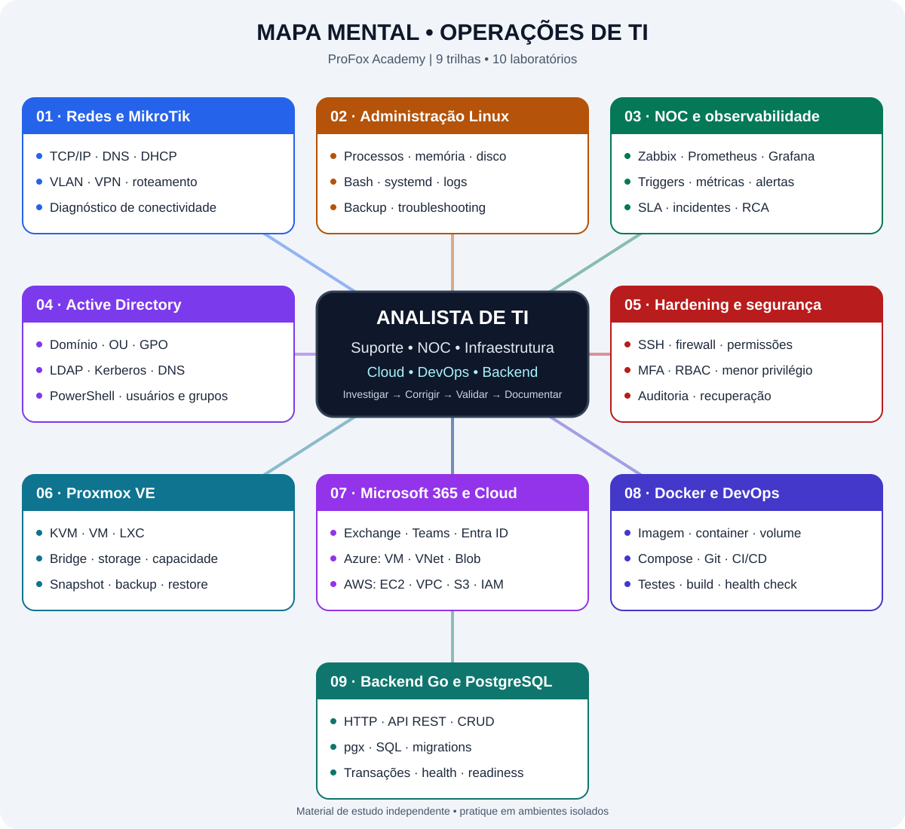

# Olá, eu sou Hernesto Filho 👋

**Analista de Suporte de TI | NOC & Infraestrutura | Desenvolvedor PHP e Go**

Atuo com **operações de TI, monitoramento, suporte técnico e desenvolvimento de sistemas empresariais**. Minha experiência une a rotina de sustentação de ambientes com a construção de soluções web, automações e administração de servidores Linux.

📍 Brasília/DF e entorno · 🌐 Interesse em oportunidades remotas ou no DF  
🎯 **Aberto a oportunidades:** Suporte N1/N2, NOC, Operações de TI, Infraestrutura, Desenvolvimento PHP/Go e posições júnior com práticas DevOps.

## 💼 Experiência profissional

### Operações de TI e suporte — Stefanini | Projeto Sicoob
- Monitoramento operacional de **jobs e steps do SISBR 2.0** e acompanhamento de alertas no **Zabbix**.
- Registro, acompanhamento e escalonamento de incidentes.
- Apoio a análises técnicas com **SQL**, troubleshooting e procedimentos de operação.
- Atuação em ambiente corporativo com atenção a continuidade e segurança da informação.

### Desenvolvimento de sistemas — ProFox Networks
- Desenvolvimento e manutenção de aplicações empresariais com **PHP, JavaScript e SQL**.
- Trabalho com o **SISLOC**, sistema de gestão de locação e operações para empresas de eventos.
- Integrações, APIs, automações e administração de aplicações em **VPS Linux**.
- Estudos e projetos em **Go, HTMX, Alpine.js, PostgreSQL, Docker e CI/CD**.

### Suporte e desenvolvimento — Micro Leader Informática
- Experiência com suporte a usuários, manutenção de equipamentos, redes e sistemas comerciais.
- Desenvolvimento e integração de soluções web e sistemas de gestão.

## 🛠️ Tecnologias e competências

| Área | Conhecimentos |
| --- | --- |
| **Suporte / NOC** | Zabbix, monitoramento, incidentes, troubleshooting, ITIL, SLA, análise de logs |
| **Infraestrutura** | Linux, Windows Server, Active Directory, MikroTik, TCP/IP, DNS, DHCP, VPN, VLAN, VPS |
| **Backend** | PHP, Go, SQL, APIs REST, MySQL, PostgreSQL, Firebird |
| **Frontend** | HTML, CSS, JavaScript, HTMX, Alpine.js, Tailwind CSS |
| **Automação / DevOps** | Bash, PowerShell, Docker, Git, GitHub Actions, CI/CD |
| **Ferramentas adicionais** | Python básico, Proxmox, VMware, Grafana, Microsoft 365 |

## 🚀 Projetos em destaque

### 🏗️ [ProFoxTruss](https://github.com/hernestodf/profoxtruss)
Aplicação web para planejamento de estruturas de eventos, com **editor visual 2D/3D**, PHP, Alpine.js, Fabric.js, Three.js e testes E2E com Playwright.

### ⚙️ [ConectaFramework](https://github.com/hernestodf/ConectaFramework)
Framework **PHP MVC** com roteamento, organização em camadas, controle de permissões e mecanismos de proteção para aplicações web.

### 🤖 [Engenharia de IA Aplicada](https://github.com/hernestodf/engenharia-ia-aplicada)
Kit de engenharia de software assistida por IA, com **agentes, skills, auditorias, testes e instalação controlada**.

### 🧾 [FaturamentoProfox](https://github.com/hernestodf/FaturamentoProfox)
Aplicação de faturamento em PHP com geração de documentos, visualização e exportação em PDF.

### 🧠 [Capital — AI Bootstrap Kit](https://github.com/hernestodf/capital)
Ferramentas para estruturar instruções, memória e automações de agentes de IA em projetos de software.

> Alguns sistemas empresariais nos quais atuo são privados. Os repositórios públicos acima apresentam projetos e tecnologias que posso compartilhar.

## 🧪 Laboratórios de infraestrutura e backend

Projetos demonstrativos **independentes**, com dados fictícios e sem código de produção:

- 🌐 **[Laboratório de Redes e MikroTik](labs/redes-mikrotik/README.md)** — TCP/IP, VLAN, DNS, DHCP, roteamento, diagnóstico e testes de endereçamento.
- 🐧 **[Laboratório de Administração Linux](labs/linux-administracao/README.md)** — Diagnóstico, logs, serviços, rede, backup, Bash, Docker e testes automatizados.
- 📡 **[Laboratório de Monitoramento NOC](labs/noc-monitoring-lab/README.md)** — Prometheus, Grafana, Alertmanager, incidentes simulados, runbooks e CI.
- 🐳 **[ProFox DevOps Lab](labs/profox-devops-lab/README.md)** — Docker, Compose, health checks, Go e pipeline CI.
- 🐹 **[ProFox Go Backend](labs/profox-go-backend/README.md)** — API REST com Go, PostgreSQL, SQL explícito, testes e Docker.

Os laboratórios são exemplos para portfólio; a execução do pipeline e os testes devem ser verificados no GitHub Actions.

### Operações avançadas e automação

- [Automação de Jobs e Steps](labs/jobs-steps/README.md) — laboratório executável com testes e CI.
- [SQL Troubleshooting](labs/sql-troubleshooting/README.md) — laboratório executável com testes e CI.
- [Terraform e Ansible](labs/terraform-ansible/README.md) — laboratório executável com testes e CI.
- [Backup e Disaster Recovery](labs/disaster-recovery/README.md) — laboratório executável com testes e CI.
- [Kubernetes](labs/kubernetes/README.md) — laboratório executável com testes e CI.

### Ferramentas corporativas e segurança

- [SIEM e Wazuh](labs/wazuh-siem/README.md) — exercício didático com testes e CI.
- [DevSecOps](labs/devsecops/README.md) — exercício didático com testes e CI.
- [Keycloak e identidade](labs/keycloak-iam/README.md) — exercício didático com testes e CI.
- [GLPI e ITIL](labs/glpi-servicedesk/README.md) — exercício didático com testes e CI.
- [Nginx e HAProxy](labs/proxy-balanceamento/README.md) — exercício didático com testes e CI.
- [RabbitMQ e Redis](labs/mensageria-cache/README.md) — exercício didático com testes e CI.
- [Jenkins e GitLab CI](labs/jenkins-gitlab-ci/README.md) — exercício didático com testes e CI.
- [Loki e OpenTelemetry](labs/observabilidade-avancada/README.md) — exercício didático com testes e CI.

## 🧠 Minha jornada de aprendizado em TI

[**Abrir guia de estudos completo**](estudos/README.md) — 22 trilhas com analogias, conceitos, comandos, exercícios e perguntas de entrevista conectadas aos 23 laboratórios.

## 📚 Desenvolvimento profissional

- **Ciência da Computação** — graduação em andamento.
- Aprimoramento contínuo em **Linux, operações NOC, ITIL, desenvolvimento backend e automação**.
- Interesse em boas práticas de testes, observabilidade, segurança e entrega contínua.

## 📫 Contato

- **LinkedIn:** [linkedin.com/in/hernesto-filho](https://www.linkedin.com/in/hernesto-filho/)
- **E-mail:** [hernestodf@gmail.com](mailto:hernestodf@gmail.com)
- **GitHub:** [github.com/hernestodf](https://github.com/hernestodf)

---

*Tecnologia aplicada para resolver problemas reais: da operação de infraestrutura ao desenvolvimento de software.*

### Monitoramento Zabbix

- [Laboratório Zabbix](labs/zabbix-monitoramento/README.md) — Zabbix 7.0, PostgreSQL, Docker Compose, agente, incidentes e testes do simulador.

### Administração e virtualização

- [Active Directory e PowerShell](labs/active-directory/README.md) — inventário fictício, OUs, GPO e diagnóstico.
- [Hardening Linux](labs/hardening-linux/README.md) — auditoria didática de SSH e permissões.
- [Proxmox VE](labs/proxmox/README.md) — planejamento de VMs/LXC, capacidade, backup e recuperação.

### Computação em nuvem e Microsoft 365

- [Microsoft 365, Entra ID, Azure e AWS](labs/cloud-m365-azure-aws/README.md) — inventário fictício, auditoria de identidade e recursos cloud, PowerShell e Python.
