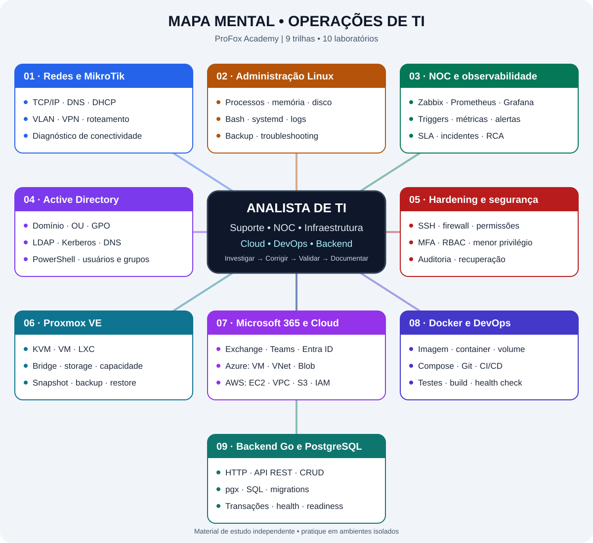

# ProFox Academy — Mapa mental e guia de estudos

Material independente de revisão prática. Inspirado em aprendizagem visual, analogias e recuperação ativa do conhecimento.

[Ver SVG em tamanho integral](mapa-mental.svg)

## Como estudar

Leia a analogia, explique o conceito sem consultar o texto, execute o laboratório em ambiente isolado e responda à pergunta. Registre evidências e erros encontrados. Os projetos são demonstrações, não comprovação de implantação em produção.

## 1. Redes e MikroTik

**Entenda:** Pense em uma cidade: IP é o endereço, DNS é a agenda e o gateway é a saída para outras redes. DHCP fornece endereços e outros parâmetros; VLAN separa domínios de broadcast; firewall controla tráfego. Um switch encaminha quadros e um roteador encaminha pacotes entre redes.

**Pratique:** `ip addr`, `ip route`, `ping`, `dig`, `ss -tuln`. Se o IP funciona e o nome não, investigue resolução DNS antes de mudar a rede.

**Pergunta de entrevista:** Explique por que VLAN não equivale a VPN.

[Laboratório correspondente](../labs/redes-mikrotik/README.md)

## 2. Administração Linux

**Entenda:** O kernel administra recursos; processos executam tarefas e serviços podem ser gerenciados pelo systemd. Logs ajudam a correlacionar sintomas com eventos. Memória livre baixa não prova falta de RAM: observe memória disponível, swap e pressão de memória.

**Pratique:** `top`, `free -h`, `df -h`, `df -i`, `systemctl status`, `journalctl -u SERVICO`. Em lentidão, avalie CPU, memória, disco, rede e logs; não reinicie sem investigar.

**Pergunta de entrevista:** Qual a diferença entre df e du?

[Laboratório correspondente](../labs/linux-administracao/README.md)

## 3. NOC, Zabbix e observabilidade

**Entenda:** O NOC é uma central de sinais vitais. No Zabbix, host representa um recurso, item coleta dados, trigger avalia condições e template reutiliza configurações. Prometheus coleta métricas; Grafana visualiza; Alertmanager agrupa e encaminha notificações. SLA é o acordo de nível de serviço; MTTA mede reconhecimento e MTTR depende da definição operacional adotada.

**Pratique:** Execute o simulador NOC e compare estados saudável, falha e recuperação. No Zabbix, configure o agente no ambiente de teste e valide coleta e triggers. Registre impacto, evidências, escalonamento e recuperação.

**Pergunta de entrevista:** Qual a diferença entre métrica, alerta e incidente?

[Laboratório correspondente](../labs/noc-monitoring-lab/README.md) · [Laboratório Zabbix](../labs/zabbix-monitoramento/README.md)

## 4. Active Directory e PowerShell

**Entenda:** AD DS centraliza identidades e computadores em domínios; o controlador de domínio presta serviços de diretório e autenticação. OUs organizam objetos e permitem delegação e vinculação de GPOs; grupos atribuem acessos. Kerberos autentica e LDAP permite consultar o diretório. DNS correto é essencial.

**Pratique:** Em ambiente autorizado: `Get-ADUser -Filter *`, `Get-ADGroup -Filter *`, `gpresult /r`, `Resolve-DnsName`. Investigue domínio, DNS, horário, conta e políticas quando um login falha.

**Pergunta de entrevista:** Qual a diferença entre uma OU e um grupo de segurança?

[Laboratório correspondente](../labs/active-directory/README.md)

## 5. Hardening e segurança

**Entenda:** Segurança em camadas reduz superfície de ataque: atualizações, firewall, autenticação, permissões, auditoria e backup. Permissão 600 significa leitura e escrita pelo proprietário, sem permissões para grupo ou outros. MFA exige fatores distintos e RBAC distribui acesso por funções.

**Pratique:** Revise `ss -tuln`, `ls -l` e, com autorização, `sshd -T`. Teste mudanças em VM com acesso alternativo, evitando bloquear o próprio SSH. O auditor do lab analisa apenas dados didáticos.

**Pergunta de entrevista:** Por que desativar autenticação por senha exige validar uma alternativa primeiro?

[Laboratório correspondente](../labs/hardening-linux/README.md)

## 6. Proxmox VE

**Entenda:** Imagine um prédio: VMs são apartamentos com sistemas operacionais próprios; LXC compartilha o kernel Linux do host. KVM fornece virtualização, bridges conectam redes e storage guarda discos. Snapshot preserva um estado, mas não substitui backup independente.

**Pratique:** Em host de teste autorizado: `pveversion`, `qm list`, `pct list`, `pvesm status`. Planeje memória, CPU e disco; restaure backup com ID distinto e valide a aplicação.

**Pergunta de entrevista:** Quando escolher VM em vez de LXC?

[Laboratório correspondente](../labs/proxmox/README.md)

## 7. Microsoft 365, Entra ID, Azure e AWS

**Entenda:** Microsoft 365 oferece serviços SaaS, como Exchange Online, Teams e SharePoint. Entra ID gerencia identidades em nuvem e não é equivalente ao AD DS. Azure VM e EC2 oferecem IaaS; VNet e VPC são redes virtuais; Blob e S3 armazenam objetos. Azure RBAC e AWS IAM controlam acesso com modelos distintos.

**Pratique:** Execute os auditores Python e PowerShell do inventário fictício. Investigue login por licença, identidade, MFA, políticas e estado do serviço. Qualquer conta real exige autorização e controle de custos.

**Pergunta de entrevista:** Compare IaaS, PaaS e SaaS. Qual a função de MFA e do menor privilégio?

[Laboratório correspondente](../labs/cloud-m365-azure-aws/README.md)

## 8. Docker e DevOps

**Entenda:** Dockerfile é a receita; imagem é o pacote; container é a instância em execução. Volumes persistem dados e redes conectam serviços. Compose descreve múltiplos containers. CI automatiza integração e validação; CD entrega ou implanta alterações conforme o fluxo adotado.

**Pratique:** `docker compose config`, `docker compose up -d`, `docker compose ps`, `docker compose logs`. Verifique testes, build e health checks antes de deploy. Revise o GitHub Actions do laboratório.

**Pergunta de entrevista:** Por que um container não substitui um backup de banco?

[Laboratório correspondente](../labs/profox-devops-lab/README.md)

## 9. Backend Go e PostgreSQL

**Entenda:** Uma requisição HTTP chega ao handler Go, passa pelas regras de negócio e usa pgx para consultar PostgreSQL. CRUD organiza operações sobre dados. Migrations versionam o esquema; transações agrupam operações atômicas; consultas parametrizadas evitam injeção SQL. Health e readiness têm objetivos distintos.

**Pratique:** `go test ./...`, `go vet ./...`, `curl` nos endpoints documentados. Rode o Compose de teste e confira persistência, respostas HTTP e erros.

**Pergunta de entrevista:** Qual a diferença entre health check e readiness?

[Laboratório correspondente](../labs/profox-go-backend/README.md)

## Revisão de 30 dias

| Período | Tema |
|---|---|
| Dias 1–4 | Redes |
| Dias 5–8 | Linux |
| Dias 9–12 | NOC e Zabbix |
| Dias 13–16 | AD e PowerShell |
| Dias 17–19 | Hardening |
| Dias 20–22 | Proxmox |
| Dias 23–26 | Microsoft 365 e Cloud |
| Dias 27–29 | DevOps, Go e PostgreSQL |
| Dia 30 | Revisão e entrevista simulada |
