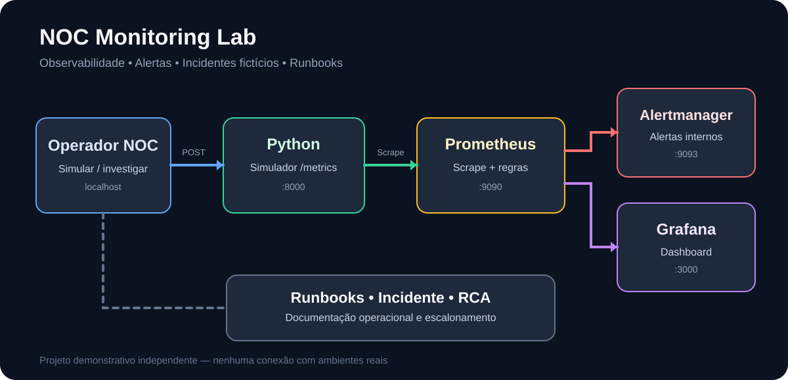

# Laboratório de Monitoramento NOC

Laboratório público e **100% fictício** para demonstrar monitoramento de serviços, alertas, investigação de incidentes e runbooks de operação NOC.

**Tecnologias:** Prometheus, Alertmanager, Grafana, Python (stdlib), Docker Compose, testes `unittest` e GitHub Actions.



**[Resumo rápido do projeto](RESUMO.md)** · **Apresentação visual:** [Visão geral para recrutadores](docs/portfolio-presentation.md) · [Arquitetura](docs/architecture.md) · [Como obter capturas reais](docs/evidence-guide.md)

## Arquitetura

```text
[simulador HTTP /metrics] --coleta--> [Prometheus] --regras--> [Alertmanager]
                                              |
                                              +--> [Painel Grafana]
```

- **Prometheus:** http://localhost:9090
- **Alertmanager:** http://localhost:9093
- **Grafana:** http://localhost:3000 (usuário `admin`; senha definida por `GRAFANA_ADMIN_PASSWORD`)
- **Simulador:** http://localhost:8000 (somente loopback)

Os alertas são internos ao laboratório; **não há envio de e-mail, SMS, Telegram ou WhatsApp**.

## Pré-requisitos

Docker Engine com plugin Compose. Este laboratório não usa endpoints, senhas ou dados de empresas reais.

## Início rápido

```bash
cd labs/noc-monitoring-lab
cp .env.example .env
# Edite .env e defina uma senha exclusiva para o Grafana.
docker compose up --build -d
docker compose ps
curl -fsS http://127.0.0.1:8000/healthz
curl -fsS http://127.0.0.1:8000/metrics
```

Abra o dashboard **NOC Lab / Visão Geral** no Grafana. O provisionamento do datasource e dashboard é automático.

## Simular incidentes

O simulador começa com serviço saudável, latência de 50 ms e zero erros.

```bash
# Incidente 1: indisponibilidade lógica do serviço (métrica passa a 0)
curl -fsS -X POST 'http://127.0.0.1:8000/simulate?scenario=down'

# Incidente 2: latência elevada (1,5 segundo, valor simulado)
curl -fsS -X POST 'http://127.0.0.1:8000/simulate?scenario=latency'

# Incidente 3: aumento da taxa de erros (25%, valor simulado)
curl -fsS -X POST 'http://127.0.0.1:8000/simulate?scenario=errors'

# Recuperar serviço
curl -fsS -X POST 'http://127.0.0.1:8000/simulate?scenario=healthy'
```

Aguarde o intervalo de coleta (15 s) e o período `for` das regras (30 s). Veja os alertas em http://localhost:9090/alerts e http://localhost:9093.

**Importante:** o cenário `down` simula falha de negócio por meio de uma métrica. Ele não derruba o container nem o endpoint `/metrics`; assim, a telemetria continua disponível para análise.

## Guias operacionais (runbooks)

- [Serviço indisponível](runbooks/service-down.md)
- [Latência elevada](runbooks/high-latency.md)
- [Taxa de erros elevada](runbooks/high-error-rate.md)

## Gestão de incidentes (exercício)

- [INC-2026-001: chamado fictício completo](incidents/INC-2026-001.md)
- [RCA-2026-001: análise de causa raiz](incidents/RCA-2026-001.md)
- [Matriz de severidade, SLA e escalonamento](incidents/SEVERITY-SLA.md)
- [Modelo reutilizável de incidente](incidents/TEMPLATE.md)

A linha do tempo, os tempos de atendimento e as metas de SLA são **hipotéticos**. Não são medições de sistemas empresariais.

## Testes e validação

```bash
python3 -m unittest discover -s simulator/tests -v
sh scripts/smoke.sh # execute após docker compose up -d
docker compose config -q
docker compose run --rm --no-deps prometheus promtool check rules /etc/prometheus/alerts.yml
docker compose run --rm --no-deps prometheus promtool check config /etc/prometheus/prometheus.yml
```

No CI, os testes Python, testes HTTP com servidor local, validação de configurações, construção da imagem Docker e teste de verificação do contêiner em execução são automatizados. O teste de verificação simula indisponibilidade e recuperação; a verificação visual de alertas no Grafana/Prometheus continua sendo uma etapa manual.

## Segurança e limites

- Portas publicadas **somente em 127.0.0.1**, não expostas à rede externa.
- `POST /simulate` **não possui autenticação** e é destinado exclusivamente ao ambiente local.
- Credenciais de exemplo não são adequadas para produção; altere a senha em `.env`.
- Sem serviços empresariais reais, sem webhook externo e sem dados pessoais.
- Imagens de terceiros têm tags de versão; para produção, use digests imutáveis, hardening adicional e políticas de atualização.
- Para encerrar: `docker compose down`. Para apagar os volumes do laboratório: `docker compose down -v`.

**Objetivo do portfólio:** demonstrar raciocínio de NOC, SRE básico, observabilidade, análise de incidentes e documentação operacional.
