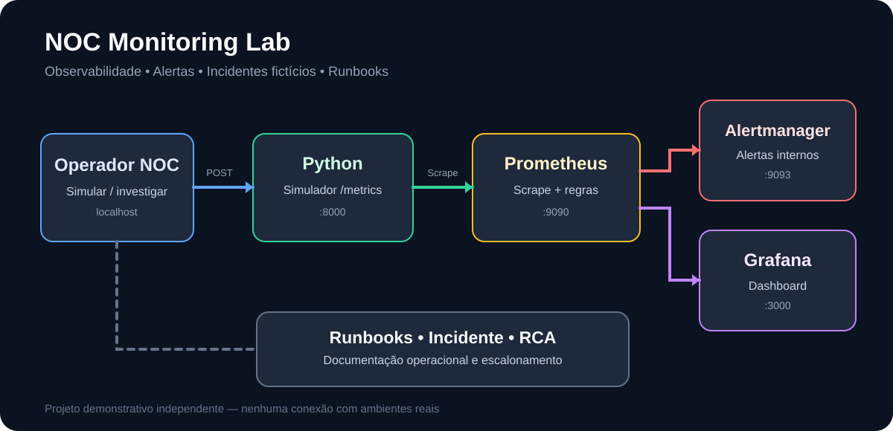
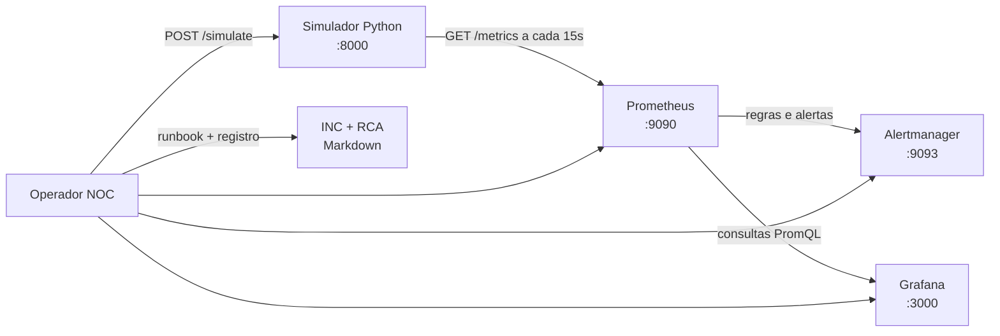

# Arquitetura do Laboratório de Monitoramento NOC

> Ambiente didático e isolado, com dados fictícios. As portas são publicadas apenas no loopback do computador que executa o Compose.

## Fluxo de observabilidade

### Componentes

| Componente | Responsabilidade | Evidência |
|---|---|---|
| Simulador Python | Exporta métricas e alterna cenários | `/metrics`, `/state` |
| Prometheus | Coleta métricas e avalia regras | Targets, Graph e Alerts |
| Alertmanager | Agrupa alertas recebidos, sem notificações externas | Página de alertas |
| Grafana | Visualiza disponibilidade, latência e erros | Painel configurado automaticamente |
| Runbooks | Orientam diagnóstico, escalonamento e recuperação | Documentos Markdown |
| GitHub Actions | Executa testes, validações e smoke test Docker | Fluxo de integração contínua do laboratório |

## Limites e segurança

- Não há integração com infraestrutura corporativa.
- O Alertmanager usa um receiver local sem envio de notificações.
- O endpoint de simulação não possui autenticação: **não exponha o laboratório à internet**.
- O dashboard é uma visualização; alertas são definidos e avaliados pelo Prometheus.
