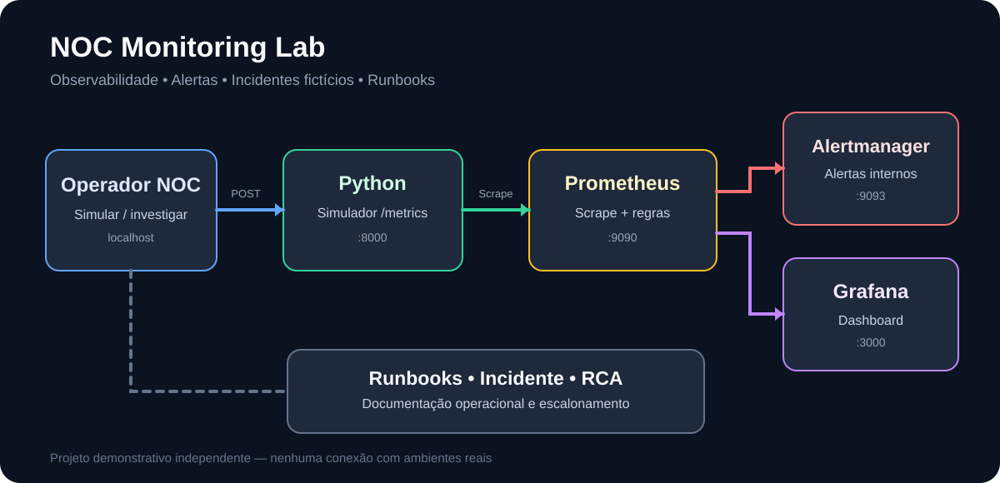

# Apresentação do projeto — NOC Monitoring Lab

## O problema

Como detectar, classificar, investigar e documentar uma falha de serviço com ferramentas de observabilidade, sem depender de infraestrutura empresarial?

## A solução

Ambiente Docker Compose isolado com simulador HTTP em Python, Prometheus para coleta e regras, Alertmanager para gestão local de alertas e Grafana para dashboards.

## Demonstração

1. O simulador inicia saudável e exporta métricas Prometheus.
2. O operador seleciona um cenário fictício: indisponibilidade, latência ou erros.
3. O Prometheus detecta a condição e dispara um alerta após a janela configurada.
4. O operador consulta métricas e runbooks, classifica o incidente e registra a investigação.
5. O operador restaura o estado saudável e verifica a recuperação.
6. O caso é documentado em um registro INC e um RCA fictícios.

## Competências demonstradas

**NOC / Suporte N2:** triagem, análise de métricas, incidentes, runbooks, priorização, escalonamento, RCA.

**Infraestrutura / DevOps:** Docker Compose, observabilidade, configuração declarativa, GitHub Actions, testes automatizados, troubleshooting.

**Desenvolvimento:** Python stdlib, endpoints HTTP, métricas, testes unitários e testes HTTP.

## Evidências verificáveis

- [Código do simulador](../simulator/app.py)
- [Regras de alerta](../prometheus/alerts.yml)
- [Workflow de CI](../../../.github/workflows/noc-monitoring-lab.yml)
- [Registro de incidente fictício](../incidents/INC-2026-001.md)
- [RCA fictício](../incidents/RCA-2026-001.md)
- [Guia para capturar screenshots reais](evidence-guide.md)

## Limitações

Este projeto é um laboratório didático, não um sistema NOC de produção. A linha do tempo do incidente é fictícia, o CI não substitui testes de carga ou segurança, e capturas reais do dashboard ainda precisam ser coletadas em ambiente executado.
